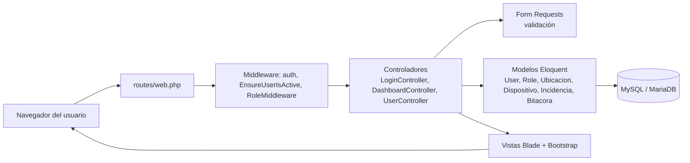
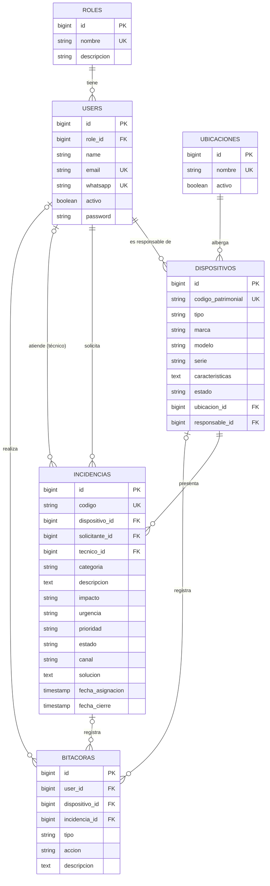

# SIGEDI – Arquitectura y modelo de datos (Sprint 1)

Evidencia de HT01 (arquitectura MVC) y HT02 (modelo relacional).

## 1. Arquitectura en capas (MVC sobre Laravel)

| Capa | Ubicación en el proyecto | Responsabilidad |
|---|---|---|
| Rutas | `routes/web.php` | Define URL, verbo HTTP, controlador y middleware |
| Middleware | `app/Http/Middleware` | Autenticación, usuario activo, control de acceso por rol |
| Controlador | `app/Http/Controllers` | Orquesta la petición; no contiene reglas de datos |
| Validación | `app/Http/Requests` | Reglas y mensajes en español |
| Modelo | `app/Models` | Acceso a datos y relaciones |
| Vista | `resources/views` | Presentación (Blade + Bootstrap 5, responsive) |
| Base de datos | `database/migrations`, `database/seeders` | Estructura versionada y datos iniciales |
| Pruebas | `tests/Feature` | Verificación automática de criterios de aceptación |

## 2. Modelo entidad-relación

## 3. Decisiones de diseño

- **Roles:** tabla propia (`roles`) con tres valores: administrador, técnico y usuario (RF01, RF02).
- **Usuarios inactivos:** no se eliminan; se desactivan para conservar el historial de incidencias y bitácora.
- **Seguridad (RNF01):** contraseñas con bcrypt (cast `hashed`), protección CSRF de Laravel, regeneración de sesión al ingresar, límite de 5 intentos fallidos por minuto y control de acceso por rol (error 403).
- **Eliminaciones:** las claves foráneas de bitácora y responsable usan `nullOnDelete` para no perder trazabilidad; dispositivo e incidencia usan restricción.
- **Claves de unicidad:** `codigo_patrimonial` (HU03), `codigo` de incidencia (HU09), `email` y `whatsapp` de usuario.
