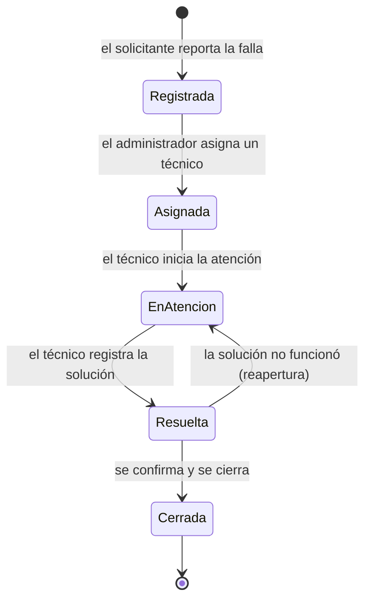

# SIGEDI – Gestión de incidencias (Sprint 3)

Evidencia para el informe: flujo de estados, matriz de prioridad y permisos por rol.

## Flujo de estados (ITIL 4)

Reglas:
- Solo se permiten las transiciones del diagrama; cualquier otra se rechaza con un mensaje.
- Para pasar a **Resuelta** o **Cerrada** es obligatorio registrar la **solución aplicada**.
- Una incidencia **Asignada** o **Registrada** puede reasignarse; una que ya está en atención, no.

## Matriz de prioridad (impacto × urgencia)

| Impacto \ Urgencia | Alta | Media | Baja |
|---|---|---|---|
| **Alto** | Crítica | Alta | Media |
| **Medio** | Alta | Media | Baja |
| **Bajo** | Media | Baja | Baja |

Colores: Crítica (rojo), Alta (naranja), Media (celeste), Baja (verde).

## Código de la incidencia

Formato `INC-AAAA-NNN` (ejemplo: `INC-2026-001`). La numeración reinicia cada año y pasa a cuatro dígitos después de la 999.

## Permisos por rol

| Acción | Usuario solicitante | Técnico | Administrador |
|---|---|---|---|
| Registrar incidencia | Sí | Sí | Sí |
| Ver incidencias | Solo las suyas | Todas | Todas |
| Reclasificar impacto y urgencia | No | Sí | Sí |
| Asignar técnico | No | No | Sí |
| Cambiar estado y registrar solución | No | Solo las asignadas a él | Todas |
